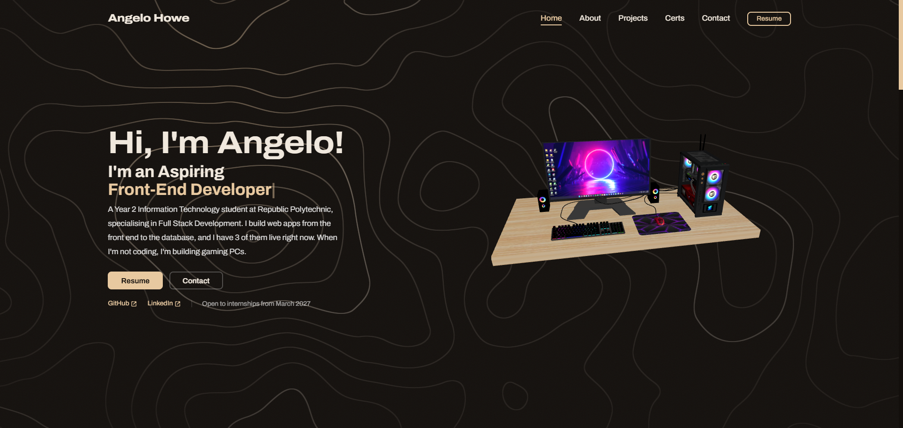

# Angelo's Portfolio Website

My personal portfolio website, where I show my projects, design work, certifications and a bit about me.

**Live site:** [angelohowe.vercel.app](https://angelohowe.vercel.app)

## Pages

- **Home:** intro, 3D model, selected work and a contact section
- **About:** who I am, my journey (education and volunteering) and tech stack
- **Projects:** all my projects with filters (Front-End, Full-Stack, Data Analysis, Team Projects, UI/UX Design)
- **Certs:** certificates grouped by issuer and online courses, with a preview of each certificate on hover
- **Contact:** a working contact form and my socials

## Features

- Interactive 3D model of a gaming PC made with Three.js
- Animated topographic map background written as a WebGL shader, with contour lines that slowly shift like terrain
- A soft hill rises under your mouse and its lines light up in the accent colour
- The map slides as you scroll, like moving across the terrain
- Background colours are read from the CSS variables, so changing the theme also changes the map
- Background is capped at 30 frames a second, so it stays smooth on laptops
- Selected work section where the heading stays on screen and highlights the project you're looking at
- Certificate preview that follows your mouse on the certs page
- Typing animation in the hero section
- Scroll animations where each item fades in as it comes into view
- Project filters, where a project can sit in more than one category
- Image gallery popup for my design work, with arrow buttons and keyboard controls
- Working contact form that sends messages straight to my email (Formspree)
- Resume button in the navbar that opens my resume PDF
- Full screen menu on phones and tablets
- Fully responsive for laptop, tablet and mobile
- Animations turn off for users who have "reduce motion" switched on in their device settings

## Projects

- **PC Build Planner:** full stack PC part picker with user accounts and saved builds (React, Express, MongoDB)
- **Angelo's Pizza Co.:** pizza ordering app with a saved cart and checkout (React)
- **Who's That Bloke?:** football quiz game (React)
- **StudyHub:** group web app for Information Technology students (Node.js, Express, MySQL)
- **HDB Resale Price Analysis:** data analysis and Tableau dashboard (Python, pandas, Tableau)
- **Man United Since Ferguson:** data analysis and Tableau dashboard (Python, pandas, Tableau)
- **PolyPath:** group AI career advisor chatbot
- **Time2Play:** mobile app UI/UX design in Figma, G121 Silver Medallion Award
- **SG Green Plan 2030:** website UI design and email newsletter

## Tech Stack

- HTML
- CSS
- JavaScript
- Three.js
- WebGL (GLSL shader for the background)
- Formspree (contact form)
- Archivo font (Google Fonts), Boxicons, Devicon and Iconify icons
- Hosted on Vercel

## Credits

3D model from Sketchfab, licensed under [CC BY 4.0](https://creativecommons.org/licenses/by/4.0/):
- ["Gaming Desktop PC"](https://sketchfab.com/3d-models/gaming-desktop-pc-d1d8282c9916438091f11aeb28787b66) by Yolala3D (Y3D), used on the home page

## Author

Angelo Howe, Year 2 Information Technology student at Republic Polytechnic, specialising in Full Stack Development
GitHub: [Aangelo555](https://github.com/Aangelo555)
LinkedIn: [Angelo Howe](https://www.linkedin.com/in/angelo-h-a74b47377/)