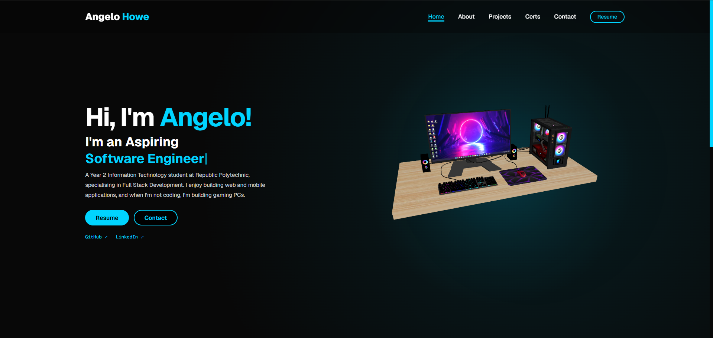

# Angelo's Portfolio Website

My personal portfolio website, where I show my projects, certifications and a bit about me.

**Live site:** [aangelo555.github.io/Angelo-s-Portfolio-Website](https://aangelo555.github.io/Angelo-s-Portfolio-Website/)

## Pages

- **Home:** intro, 3D model, featured projects
- **About:** who I am, skills and tech stack
- **Projects:** all my projects with filters (Front-End, Full-Stack, Group, UI/UX)
- **Certs:** certifications and courses
- **Contact:** contact form and socials

## Features

- Interactive 3D model on the home page made with Three.js
- Typing animation in the hero section
- Scroll animations when sections come into view
- Project filter buttons
- Fully responsive for laptop, tablet and mobile

## Tech Stack

- HTML
- CSS
- JavaScript
- Three.js
- Hosted on GitHub Pages

## Credits

3D models from Sketchfab, both licensed under [CC BY 4.0](https://creativecommons.org/licenses/by/4.0/):
- ["Gaming Desktop PC"](https://sketchfab.com/3d-models/gaming-desktop-pc-d1d8282c9916438091f11aeb28787b66) by Yolala3D (Y3D), used on the home page
- ["Certificate"](https://sketchfab.com/3d-models/certificate-409d9c30c88946558e4e278eb58de61a) by NoLagHere, used on the certs page

## Author

Angelo, Year 2 IT student at Republic Polytechnic
GitHub: [Aangelo555](https://github.com/Aangelo555)
LinkedIn: [Angelo Howe](https://www.linkedin.com/in/angelo-h-a74b47377/)
